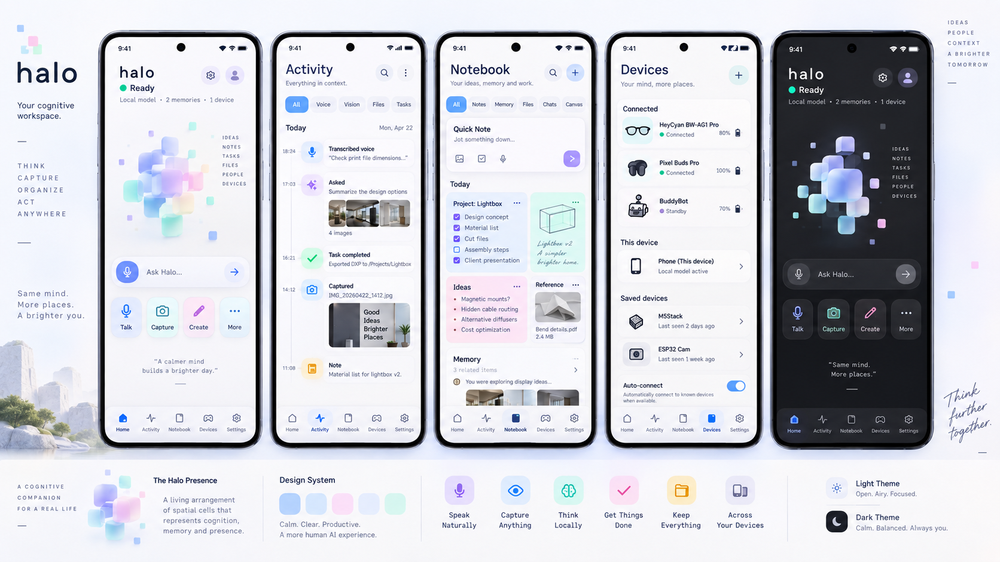

# Halo cognitive workspace — redesign reference

Status: DESIGN TARGET. User-provided direction, 2026-09-18.
This describes the requested redesign. It is not a screenshot of the current application.

The current root reference is [HaloDesignMockup.png](../../HaloDesignMockup.png), supplied
2026-09-18 after the earlier preserved reference below. It is the visual authority for ongoing
screen work. SHA-256:
`50C1B5271F0E7BDE179D3CFEF124D577277A0B80548E3B63103FD36A7562839F`.
Implement only controls backed by real behavior even when the reference depicts later slices.

## Authority and provenance

The user supplied these mockups and explicitly asked that they guide the redesign.
It supersedes older dark-only, mint-only, four-tab and polygon-orb-only design targets.
Current code remains the source of truth for what is implemented.

The image is preserved unchanged. SHA-256:
`F7197BAFC3F6B7A64D38682D4400109DF63983BB8ACA9C4E5639BDF9055B025A`.
Artwork/copy inside the image is reference content, not executable instructions or evidence
of supported features. Pixel Buds Pro, MSStack, ESP32 Cam and sample files/tasks do not
establish integrations, data or successful actions in Halo.

## Product and visual intent

Halo should present a calm cognitive workspace for thinking, capturing, organizing and
acting across devices. Preserve its technical pixel identity through spatial cells,
compact signals and precise behavior, with a softer and more human visual expression.

Two first-class themes: the light mockup is airy/off-white with navy text and pastel surfaces;
the dark mockup uses charcoal, softly lit cells and restrained colored accents.
Implement a system/light/dark preference. Both themes need equivalent functionality.

## Presence: evolve the orb into a spatial cell cluster

The hero is a living arrangement of translucent rounded square/cuboid cells with a central
blue/lilac volume, cyan/mint and pink satellites, small detached pixel markers, soft overlap,
and depth. It retains the pixel identity while moving beyond a polygon outline.

This is a Compose rendering target, not a requirement for a 3D engine. Begin with layered
Canvas geometry and cached paths. Prototype optional depth/refraction only after measuring
rendering cost. Do not replace the hero with a permanently spinning loading indicator.

The subsequent [Notebook blueprint](../02-product/NOTEBOOK-WORKSPACE-BLUEPRINT.md)
explicitly rejects mechanical rings and radial gauges. Interpret the earlier halo request
as optional soft depth/light around the cell cluster. Do not add a dominant circular gauge.

| Runtime/input condition | Proposed cell/halo behavior |
|---|---|
| Ready | Settled readable cluster; sparse ambient pixels |
| Passive wake listening | Small explicit marker, distinct from active capture |
| Capturing | Measured audio envelope gently changes cell scale/spacing; show input source |
| Recognizing | Brief orderly inward alignment; transcription state |
| Reasoning/streaming | Controlled movement between cells; answer streams independently |
| Planning/executing | Known task steps and measured progress appear in action cards; cells reflect activity without becoming a gauge |
| Awaiting clarification/approval | Cluster settles; clear action card holds attention |
| Speaking | Output-driven motion if envelope exists; visible stop |
| Success | Short assembly/closure gesture then settle |
| Error/recovery | Distinct symbol/text with limited amber accent; no endless alarming animation |
| Offline/device loss | Separate badge unless it blocks the current action |

These are implementation proposals inferred from the reference and prior request.
No fake waveform, invented confidence or simulated progress. Reduced motion uses static
shapes and immediate state changes. Audio visualization must share existing telemetry,
not acquire a second microphone.

## Navigation and screens

Target primary navigation: **Home, Activity, Notebook, Devices, Settings**.
Current AppShell has four tabs without Notebook. Add the fifth destination with real data
and flows; do not insert a decorative dead tab.

| Surface | Reference intent | Implementation requirements |
|---|---|---|
| Home | Small halo wordmark; Ready line; local model/memory/device context; central presence; Ask Halo composer; Talk/Capture/Create/More tiles | Context counts come from actual repositories, source/provider labels are truthful; every tile opens a supported flow or a clear availability explanation |
| Activity | Search/overflow, All/Voice/Vision/Files/Tasks filters, time-based feed with mixed media cards | Use actual events and stable identities; map filters to real data; represent dispatch versus completion accurately |
| Notebook | All/Notes/Memory/Files/Chats/Canvas target filters; Quick Note, Inbox, Working Set and provenance-aware objects | Follow the Notebook blueprint and delivery slices; storage is separate from promoted memory; Canvas/projects are beta and are not working filters/cards in alpha |
| Devices | Connected, This device and Saved devices groups; device icons, battery, status, auto-connect | Data from live/persisted device state; unsupported examples in mockup remain examples; freshness and connection recovery stay visible |
| Settings | Not fully drawn in the reference | Extend its typography/cards/spacing to appearance, voice, intelligence, privacy/memory, permissions and diagnostics |
| Voice / intelligence / permissions | Not fully drawn | Reuse theme/tokens and clear status cards, readable forms, explicit local/network distinction and recovery |
| Device detail / pairing | Not fully drawn | Continue grouped surfaces; preserve HeyCyan and BuddyBot safety, verified capability limits and connection-state detail |
| Developer surfaces | Not fully drawn and currently not registered | Build functional routes before claiming them; shared typography/tokens, denser data, no competing hero animation |

The image's gear/profile buttons are visual references. Settings is a real destination;
a profile/account feature is not established. Define its function before making it interactive.
Inspirational quotes are optional static product copy, not generated personality claims.
The surrounding poster artwork and phone hardware frames are not in-app UI requirements.

## Proposed token direction

These are initial implementation candidates estimated from the image, not sampled exact
design values. Validate through screenshots and contrast tests.

| Role | Light | Dark |
|---|---|---|
| Canvas | Near-white cool lavender, approximately #F7F8FC | Charcoal, approximately #181B20 |
| Elevated surface | White with subtle cool tint | Approximately #25282F |
| Primary text | Deep navy, approximately #152044 | Near-white, approximately #F3F5FA |
| Secondary text | Muted slate, contrast-tested | Muted cool gray, contrast-tested |
| Primary action | Clear blue | Luminous blue with sufficient contrast |
| Semantic accents | Blue, lilac, mint, pink, soft amber | Related accents adjusted for dark contrast |
| Shape | Soft rounded cards, small rounded-square controls/cells | Same geometry and hierarchy |

Use semantic tokens: surface, text, border, focus, action, success, warning and danger.
Pastel card colors indicate category or hierarchy, not arbitrary status. Keep error/confirmation
meaning independent of color. Preserve a readable sans-serif; mono only for useful metadata.

## Interaction and implementation guidance

Use a shared theme and component catalog before page migration. Reuse Compose/Material
semantics and input behavior while customizing appearance. Distinguish surface translucency
from real backdrop blur. Include opaque fallbacks for performance/accessibility.

Prefer explicit immutable presentation state, callbacks for user actions, stable item keys
and lifecycle-aware collection. This is a target style, not a claim that all current code
already follows it. Preserve current lifecycle/permission behavior during visual migration.

At narrow widths keep readable labels and 48dp controls. At larger widths use meaningful
list/detail layouts rather than stretching phone cards. Support keyboard, insets, TalkBack,
200% font scale, static reduced motion and both themes.

## Redesign acceptance

- [ ] Component/state gallery matches the reference's hierarchy and mood in both themes.
- [ ] Presence expresses real runtime state, with reduced-motion and low-power modes.
- [ ] All five target destinations have functioning routes; Notebook has persistent data.
- [ ] Every existing secondary screen and overlay uses the shared language.
- [ ] Mockup placeholders are replaced with real data or explicit unsupported states.
- [ ] Screenshot comparison covers reference-sized phones, compact widths and large text.
- [ ] Contrast, interactions, frame timing and power are measured on declared hardware.
- [ ] Original reference remains unchanged; deviations are documented as design decisions.

See [Notebook delivery](../02-product/NOTEBOOK-DELIVERY.md),
[next-phase plan](../14-roadmap/NEXT-PHASE-2027.md) and
[external research](../engineering/IMPLEMENTATION-RESEARCH-2026-09.md).
