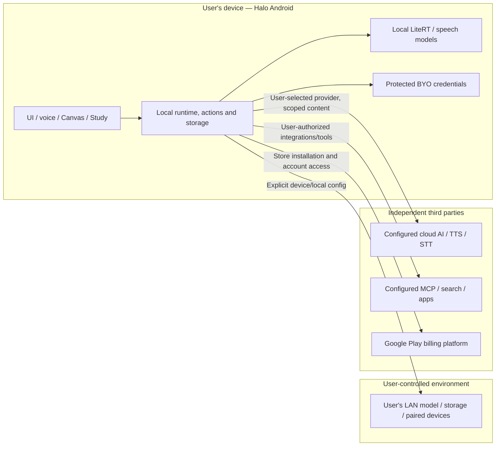

# ADR-0001 — No Halo-operated functional backend; commerce-only exception

**Status:** ACCEPTED — binding product architecture, 2026-10-21 (issue [#41](https://github.com/slafftrosheen/Halo/issues/41)).
**Scope:** Android Halo and portable Halo runtimes. This is an architectural rule, **not** a statement that the current binary is network-free, independently privacy-audited, or ready for Google Play.
**Related:** [Flow inventory and review gate](../12-security/NETWORK-FLOW-INVENTORY.md), [Commerce issue #42](https://github.com/slafftrosheen/Halo/issues/42).

## Decision

Halo has **no developer-operated server required for assistant functionality**. Runtime inference, speech, memory, Canvas/Notebook/Study/Screen, native actions, automations and optional device sync must work on user-owned compute and storage, or directly with a third-party service the user has deliberately configured. No Halo account is required.

Halo's base app will use a **paid Google Play listing**, targeting approximately US $4.99 as a one-time purchase (issue #42; confirmed 2026-10-22). Google Play delivers the app and records the buyer's store-account access. Refunds follow Google Play policy and its order-management flow; developer support and refund handling obligations still apply. Halo will not add an in-app base-app unlock, purchase-token verifier or Halo-operated commerce backend for that listing. Localized prices, taxes, availability, publication and refund support remain subject to Play Console configuration and review. See [Google Play's paid-app refund guidance](https://support.google.com/googleplay/android-developer/answer/9037917) and [order management guidance](https://support.google.com/googleplay/android-developer/answer/2741495).

The developer may consider a **strictly isolated commerce/licensing service** only if a separately scoped, optional feature pack later uses an in-app purchase. That service could handle Google Play purchase validation, entitlement state, refunds/revocations, replay protection and compliance. It is forbidden to act as an assistant, telemetry, device-sync, data-store, provider-key proxy or remote-execution backend. No such feature pack or service is implemented or approved by this decision.

A third-party service is **not** a Halo-operated service: users must see that optional cloud providers, speech services, MCP integrations and search services may process and retain shared content under their own policies. A user-controlled Ollama/LAN endpoint or personal storage remains user-owned, even though it can communicate across the network.

## Trust boundaries (data-flow model)

If a future feature-pack verifier is approved, **no data flow is permitted** from local conversations, memory, media, voice, provider API keys, automation execution or device sync to it. It may not gain access to those domains through a shared log pipeline, support dashboard or diagnostics SDK.

## Invariants

1. **Local paths are genuine.** Without Internet, locally installed models, local data and platform capabilities remain usable; cloud-only requests fail honestly or require explicit local fallback. Do not fake search/model success.
2. **No developer relay.** The app contacts a user's chosen external endpoint directly. No mandatory account, developer-run AI proxy, chat relay, memory sync, research index, background task scheduler or analytics ingestion endpoint.
3. **Context control is independent of provider selection.** Access to local content does not authorize its remote transmission. Respect exact source, privacy policy, Kids/guardian rules, credentials and permission gates.
4. **Execution is owned by a device.** Background automations need a running user-owned device; the Halo developer does not execute them while all owner devices are off.
5. **No blanket “zero data collected” claim.** Billing, third-party API processing, Google/Android components and optional user-enabled tooling are separate disclosures and must be assessed for each release.
6. **Commerce isolation is enforceable.** The verifier only handles verified purchase metadata and minimal security/operational logs. No advertising identifiers, assistant event IDs, device contents or globally reusable Halo user profile.

## Commerce-only carve-out: threat model and minimum design

| Threat | Required control |
|---|---|
| Base-app purchase access or refund | Use Google Play's paid-app delivery and order/refund mechanisms; provide a clear support contact and verify store behavior during release acceptance |
| Future feature-pack entitlement forgery or replay | If an in-app non-consumable is approved, verify purchase tokens server-side, deduplicate token references, check ownership and never log raw tokens |
| Future feature-pack refund, revocation or pending purchase | If such a pack is approved, reconcile status and design explicit offline grace; do not trust stale local state permanently |
| Future service-account secret loss | Only if a verifier is approved: keep credentials in a server secret manager, restrict scopes, rotate/revoke; **never ship credentials in APK** |
| Future commerce data leakage or outage | Only if a verifier is approved: isolate deployment, database, logs and access roles; reject content fields and define retention, backups and recovery |

There is no Halo commerce persistence for the paid base listing. If an optional feature-pack verifier is later approved, persisted fields must be limited to a hashed/token-reference key, product identifier, purchase/entitlement state, verification timestamps and necessary refund/audit records. Final fields and deletion/retention windows need a documented legal and provider-guidance review before shipping. An IP address or device diagnostics must not be stored without purpose and disclosure.

**Cost:** no developer backend is needed for assistant features or the paid base listing. If a feature-pack verifier is later adopted, cost depends on hosting, storage, egress, secret management, uptime and verification volume. Estimate and cap it before implementation; this ADR invents no monthly price.

## Source-backed rationale and limits (2026-10-21)

- `app/src/main/java/com/halo/app/di/AndroidProviderFactory.kt` constructs LiteRT, on-device speech, user-selected cloud providers, custom direct OpenAI-compatible endpoints and optional remote speech. It does not construct a developer-owned inference proxy.
- `app/src/main/java/com/halo/app/di/ProviderGraph.kt` owns local models and speech directories; `app/src/main/java/com/halo/app/di/ManualDependencyGraph.kt` composes Android host/runtime, repositories and provider graph locally.
- `app/src/main/java/com/halo/app/privacy/SharedAnswerHistory.kt` stores bounded, local metadata for **remote inference requests only**. It does not establish a complete network audit and never records payload content.
- `app/build.gradle.kts` has commented-out Firebase Auth and Firestore lines; no wired developer analytics endpoint was identified in the specific reviewed paths. The presence of dependency versions in a catalog is not proof of inclusion or execution.
- `app/src/main/AndroidManifest.xml` grants Internet and permissions to optional capabilities, which **do not** imply that all paths are local, nor are they evidence of remote collection.

These are **static code observations**, not runtime packet-capture evidence, exhaustive SDK analysis or confirmation of compiled APK behavior. See the review gate before publication.

## Non-goals and consequences

- No Halo-owned cross-device account or centralized backup. Optional sync is via user-owned devices/cloud accounts under user control.
- The developer does not promise offline operation for uninstalled models, online tools, provider-specific voices, Google services or external device operations.
- No mandatory Google account for assistant features. Installing a paid Play listing uses the buyer's Google Play account.
- Base-listing price/regions, Play Console publication, support/refund handling and store acceptance remain tracked in #42, separate from acceptance of this architectural decision. Optional feature-pack billing requires a new scoped decision.
- No retroactive claim about already-released APK permissions, libraries or Play Data Safety accuracy.

**Acceptance for #41:** ADR, diagram, inspected flow inventory, localized app disclosure and ongoing change-review checklist are committed; issue #42 retains paid-listing configuration and release acceptance.
