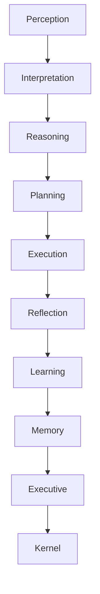

# Halo Documentation

**Root Index** - Last Updated: 2026-08-10

## Authority Hierarchy

All documentation follows this authority order (highest first):

1. **[PROJECT-DIRECTION.md](../PROJECT-DIRECTION.md)** — Canonical project direction (single source of truth)
2. **CONSTITUTION.md** (HPS-9000) — Immutable principles
3. **ARCHITECTURE-GUARDRAILS.md** — Engineering constraints
4. **04-architecture/** — System architecture specifications
5. **02-product/** — Product requirements
6. **03-design/halo-glass/** — Visual/UI design system (authoritative after PROJECT-DIRECTION.md)
7. **07-platform/** — Device platform specifications
8. **11-ui/** — UI architecture and migration guides
9. **14-roadmap/** — Execution roadmap
10. **Historical/archive/** — Reference only

---

## Documentation Domains

### ���� �� �� 📐 01-vision
Long-term vision, philosophy, platform DNA

### ���� �� �� 📋 02-product
Product requirements, PRD, success metrics

### ���� �� �� 🎨 03-design
**NOTE**: Design system has been unified under `03-design/halo-glass/` as of PROJECT-DIRECTION.md v1.0
- `halo-glass/` — **Authoritative** Halo Glass design system (materials, components, screens)
- Legacy files in this directory are SUPERSEDED (see PROJECT-DIRECTION.md)

### ���� �� �� ⚙������������️ 04-architecture
Software architecture, cognitive kernel, database, testing

### ��� � � ▶������������️ 05-runtime
Core runtime specification

### ���� �� �� 🧠 06-cognition
Cognitive architecture, memory, reasoning

### ���� �� �� 📱 07-platform
Device drivers, SDK abstractions, hardware interfaces

### ���� �� �� 🔌 08-providers
AI provider integrations (local, cloud, hybrid)

### ���� �� �� 🔌 09-plugins
Plugin architecture, marketplace, extensions

### ���� �� �� 💡 10-features
Feature specifications, user stories, acceptance criteria

###� ���� ��� �� 🖥������������️ 11-ui
**Updated**: UI architecture and component migration guides
- `UI-ARCHITECTURE.md` — Presentation layer structure
- `UI-ALPHA-SPECIFICATION.md` — Screen specifications (updated for Halo Glass)
- `migration/` — Guides for migrating from legacy components

### ���� �� �� 🔐 12-security
Threat model, privacy, data protection

### ���� �� �� 🔧 13-engineering
Development practices, performance, error philosophy

### ���� �� �� 🗺������������️ 14-roadmap
Milestones, release planning, PR sequence

### ���� �� �� 🏷������������️ 15-brand
Brand identity, logo usage, visual language

### ���� �� �� 📚 Specifications
HPS (Halo Protocol Specification) series

### ���� �� �� 📚 Protocols
HeyCyan and other device protocol documentation

---

## Key Documents to Read First

1. **[PROJECT-DIRECTION.md](../PROJECT-DIRECTION.md)** — Start here for project direction
2. **[CONSTITUTION.md](specifications/HPS-9000-CONSTITUTION.md)** — The ten immutable principles
3. **[ARCHITECTURE-GUARDRAILS.md](ARCHITECTURE-GUARDRAILS.md)** — Engineering constraints
4. **[03-design/halo-glass/HALO-GLASS-DESIGN.md](03-design/halo-glass/HALO-GLASS-DESIGN.md)** — Authoritative UI design system
5. **[11-ui/UI-ARCHITECTURE.md](11-ui/UI-ARCHITECTURE.md)** — UI layer architecture

---

## Legacy Notice

Documents marked as SUPERSEDED in PROJECT-DIRECTION.md remain for historical reference only. New contributors should ignore legacy design documents and follow the halo-glass/ directory for all UI/design guidance.

Last updated: 2026-08-10
# Halo Documentation

Welcome to the official documentation for **Halo**, the AI-first Cognitive Operating System.

## Cognitive Map

## Documentation Hierarchy

- **[01-vision](01-vision/README.md)**: Vision, Mission, Manifesto, Platform DNA, Vision 2030
- **[02-product](02-product/README.md)**: PRD, User Stories, Personas, MVP, Milestones
- **[03-design](03-design/README.md)**: Design System, Flows, Typography, Colors, Components, Accessibility, Tokens
- **[04-architecture](04-architecture/README.md)**: Repository, Architecture, Kernel, Runtime, Cognition, Memory, Providers, Drivers, Plugin System, Database, Testing, CI/CD
- **[05-runtime](05-runtime/README.md)**: Runtime API, Lifecycle, Events, Configuration
- **[06-cognition](06-cognition/README.md)**: Cognitive Engines, Inference, Memory Models
- **[07-platform](07-platform/README.md)**: Drivers, Providers, and Plugins architecture
- **[protocols](protocols/README.md)**: Evidence-backed device protocol documentation
- **[10-features](10-features/README.md)**: Shipped features and functional capabilities
- **[11-ui](11-ui/README.md)**: User Interface components and layout specifics
- **[12-security](12-security/README.md)**: Security, sandboxing, and permissions
- **[13-engineering](13-engineering/README.md)**: Engineering practices, workflow, performance, errors
- **[14-roadmap](14-roadmap/README.md)**: Alpha, Beta, Gamma, Release plans
- **[15-brand](15-brand/README.md)**: Brand identity, logo rules, aesthetics
- **[rfc](rfc/README.md)**: Request for comments
- **[archive](archive/README.md)**: Archived old iterations, roadmaps, and legacy designs
- **[specifications](specifications/README.md)**: Formal Engineering Specifications (HPS)

## Core Files
- [CONTRIBUTING.md](CONTRIBUTING.md)
- [DECISIONS.md](DECISIONS.md)
- [GLOSSARY.md](GLOSSARY.md)
- [MVP.md](MVP.md)
- [BUILD.md](BUILD.md)
- [DEBUG.md](DEBUG.md)
- [MODULES.md](MODULES.md)
