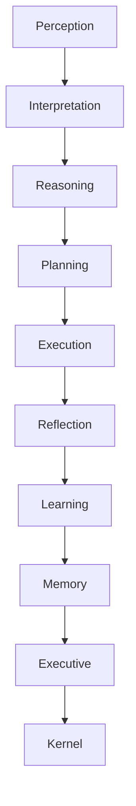

# Halo Documentation

Welcome to the official documentation for **Halo**, the AI-first Cognitive Operating System.

## Cognitive Map

## Documentation Hierarchy

- **[01-vision](01-vision/README.md)**: Vision, Mission, Manifesto, Platform DNA, Vision 2030
- **[02-product](02-product/README.md)**: PRD, User Stories, Personas, MVP, Milestones
- **[03-design](03-design/README.md)**: Design System, Flows, Typography, Colors, Components, Accessibility, Tokens
- **[04-architecture](04-architecture/README.md)**: Repository, Architecture, Kernel, Runtime, Cognition, Memory, Providers, Drivers, Plugin System, Database, Testing, CI/CD
- **[05-runtime](05-runtime/README.md)**: Runtime API, Lifecycle, Events, Configuration
- **[06-cognition](06-cognition/README.md)**: Cognitive Engines, Inference, Memory Models
- **[07-platform](07-platform/README.md)**: Drivers, Providers, and Plugins architecture
- **[protocols](protocols/README.md)**: Evidence-backed device protocol documentation
- **[10-features](10-features/README.md)**: Shipped features and functional capabilities
- **[11-ui](11-ui/README.md)**: User Interface components and layout specifics
- **[12-security](12-security/README.md)**: Security, sandboxing, and permissions
- **[13-engineering](13-engineering/README.md)**: Engineering practices, workflow, performance, errors
- **[14-roadmap](14-roadmap/README.md)**: Alpha, Beta, Gamma, Release plans
- **[15-brand](15-brand/README.md)**: Brand identity, logo rules, aesthetics
- **[rfc](rfc/README.md)**: Request for comments
- **[archive](archive/README.md)**: Archived old iterations, roadmaps, and legacy designs
- **[specifications](specifications/README.md)**: Formal Engineering Specifications (HPS)

## Core Files
- [CONTRIBUTING.md](CONTRIBUTING.md)
- [DECISIONS.md](DECISIONS.md)
- [GLOSSARY.md](GLOSSARY.md)
- [MVP.md](MVP.md)
- [BUILD.md](BUILD.md)
- [DEBUG.md](DEBUG.md)
- [MODULES.md](MODULES.md)
