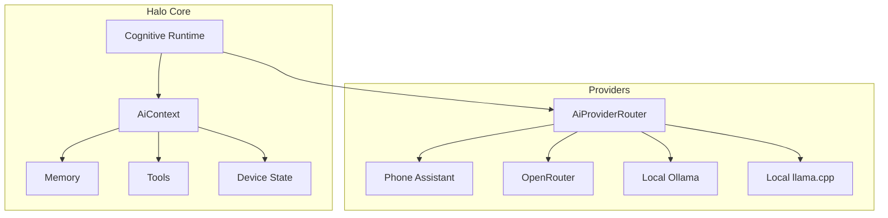

# Halo AI Provider Architecture

## Overview
Halo uses a provider-neutral architecture where different reasoning backends can be swapped without disconnecting the system's cognitive state, perception, or tools.

## Key Components

### 1. AiProvider
The unified interface for all reasoning backends.
- **id**: Unique identifier (e.g., "openrouter").
- **getStatus()**: Reports if the provider is READY, UNCONFIGURED, or UNAVAILABLE.
- **generate(request, context)**: Generates a response based on multimodal input and full cognitive context.
- **listModels()**: Dynamically discovers available models from the provider's API.

### 2. AiContext
The logical state of Halo passed to the provider for every request.
- **conversation**: List of recent messages (Role + Content).
- **deviceState**: Snapshot of hardware/platform state.
- **recentEvents**: High-level timeline of what happened.
- **memories**: Long-term context (fact/episode).
- **availableTools**: Definitions of capabilities the model can call.

### 3. AiProviderRouter
Responsible for selecting the active backend and routing requests.
- Persists provider and model selection.
- Validates modalities before routing.
- Handles fallbacks between compatible providers.

## Privacy & Context Policy
Halo does not blindly upload all data to cloud providers. The `AiContextPolicy` controls what parts of the cognitive state are shared with external services.
- **Conservative (Default)**: Shares conversation and basic device state.
- **Advanced**: Enables memory, tools, and multimodal uploads (images/audio).

## Tiered Setup Logic
1. **Zero Config**: Phone Assistant (uses Android system defaults).
2. **Quick Setup**: OpenRouter (requires user API key, discovers models dynamically).
3. **Power User**: Local backends (Ollama/llama.cpp) and advanced parameters (Temperature, Context window).

## Future: Agentic Halo
The provider abstraction supports `ToolCall` in `AiResponse`. This allows models to request actions (e.g., "Take a photo") which Halo executes through its internal `ToolRegistry`, maintaining safety and hardware abstraction.
