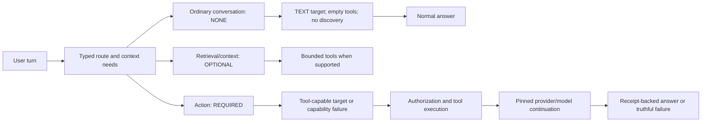

# Provider control plane — PRODUCT-P0-001

Source reviewed 2026-09-30. Actual baseline: `58c2b2a6cc791d1f1b86aa32cc82fa842e16e150` (locally merged MINING-P7). The request's older baseline was not the checkout used. No build, tests, device acceptance or account probes were performed.

## Ownership and destinations

`AiProviderRouter` and `AiSelectionRepository` remain the inference selection authority. `ProviderControlRepository` owns setup commands and small status projections, using `CredentialProvider`, protected `Storage`, preset metadata and bounded `ProviderConfigurationDescriptor` fields. It creates no additional credential store, inference router or model database. Generic configured providers can report their actual metadata; future secret keys must also be registered with the existing protected store.

| Destination | Responsibility |
| --- | --- |
| Intelligence (`ai_settings`) | Selected provider/model/status and short links; no forms or full catalogue |
| `settings/intelligence/providers` | All registered inference providers, configured/selected, location/access, health and model counts |
| `settings/intelligence/providers/{providerId}` | Replace/remove credential, endpoint/auth setup, explicit connection test and metadata refresh |
| `settings/intelligence/models` | Lazy catalogue and background filters; selected/local/recommended defaults, full remote list opt-in |
| `settings/intelligence/roles` | Existing role bindings and routing policy, compatible model picker |
| `settings/intelligence/on-device` | Existing LiteRT acquisition, import, validation and development controls |
| `settings/intelligence/policy` | Context sharing, capability packs and advanced mining controls |
| `settings/intelligence/usage` | Content-free inference/tool aggregates and System Check link |
| `settings/voice/elevenlabs` | Credential, discovered voice/TTS model choices, synthesis fallback and fixed preview |

Legacy setup/model routes use the same new owners. Model selection calls `selectTarget`; explicit non-chat roles call `setRoleBinding`. Saving configuration never changes inference or TTS selection.

## Provider setup

| Provider ID | Configuration | Credentials |
| --- | --- | --- |
| `provider.litert.local` | Local model management / System Check | None |
| `provider.ollama` | Ollama endpoint | None |
| `openrouter` | OpenRouter key | Keystore |
| `openai` | OpenAI key | Keystore |
| `anthropic` | Anthropic key | Keystore |
| `gemini` | API key or Google OAuth; project ID only on OAuth path | API key in Keystore; existing OAuth session is ephemeral |
| `groq` | Groq key | Keystore |
| `cerebras` | Cerebras key | Keystore |
| `opencode.zen` | OpenCode Zen key | Keystore |
| `xai` | xAI key | Keystore |
| `companion.opencode` | Endpoint and companion credential | Existing secret store |
| `custom.openaicompatible` | Endpoint; NONE / API_KEY / BEARER_TOKEN | Keystore when required |

Secret drafts start empty, use password transformation, are not saveable UI state and clear immediately on submission. Blank replacement preserves a key; removal is explicit. Intelligence state contains configured booleans only. Endpoint validation rejects user-info, query/fragment and public cleartext credential transport. Saving invalidates connection proof; a test racing a configuration change cannot establish readiness for the new configuration.

Connection states are NOT_CONFIGURED, CONFIGURED, CHECKING, READY, AUTH_FAILED, OFFLINE, RATE_LIMITED and ERROR. A key never proves connection. Removing a selected key preserves the preference and reports setup/authentication required. Catalogue availability is separate: LIVE, CACHED, STALE, UNAVAILABLE. Installed local inventory may be projected on entry; remote refresh is explicit and provider-scoped. Errors preserve previous entries. Router/preset entries do not claim stable concrete capabilities or guaranteed tools.

## Chat and action routing

`ToolUseMode` derives from the existing workload tool requirement: NOT_NEEDED→NONE, OPTIONAL→OPTIONAL, REQUIRED→REQUIRED. Runtime binds it into the request. Typed actionable routes, context needs and explicit hints take precedence. A small anchored operation/retrieval grammar handles otherwise untyped submissions; provider names and broad keyword lists do not determine mode.

Recipes, historical facts, creative writing and code explanations take NONE. Tool assembly returns before registry discovery on NONE, and the actual send boundary strips tools too. Direct OpenAI/Anthropic/Gemini adapters honor NONE. Required first turns cannot commit text-only success and keep streaming text buffered. Discovery/skill/presentation alone cannot confirm action completion. Existing phone workflow receipts remain authoritative. Provider-start journal metadata persists mode/workload kind; older records keep bounded fallback classification. Resumed actions also check real confirmation receipts. Continuations preserve assistant/tool pairing, cannot change provider through fallback mid-loop, and may finish with normal text.

OpenRouter concrete `supportsTools` requires `supported_parameters` containing `tools`; `openrouter/free` never guarantees tools. NONE omits tools and tool choice. Native tool requests use auto, including required-action continuations; Runtime checks execution truth instead of forcing another call forever. Concrete non-tool models remain eligible for normal text. The shared Responses serializer uses flattened function declarations; chat completions retain nested declarations.

## ElevenLabs and portable playback

Official sources reviewed 2026-09-30:

- [Stream speech](https://elevenlabs.io/docs/api-reference/text-to-speech/stream): voice-specific POST, `xi-api-key`, JSON text/model and `output_format` query.
- [List voices](https://elevenlabs.io/docs/api-reference/voices/search): GET `/v2/voices`, paginated by `has_more` / `next_page_token`.
- [List models](https://elevenlabs.io/docs/api-reference/models/list): GET `/v1/models`; only `can_do_text_to_speech` models are offered.
- [Audio formats](https://elevenlabs.io/docs/help-center/troubleshooting/what-audio-formats-do-you-support): PCM support and tier restrictions.
- [OpenRouter tool calling](https://openrouter.ai/docs/guides/features/tool-calling): declarations and choice modes.

The `providers/elevenlabs-tts` module produces PCM without owning playback. POST `/v1/text-to-speech/{voice_id}/stream?output_format=pcm_24000` requests mono signed 16-bit little-endian PCM at 24 kHz, avoiding tier-gated 44.1 kHz output and MP3 decoding. Voice/model IDs come from explicit discovery, not one hardcoded voice. Non-secret cached choices have a 24-hour freshness marker; selected IDs persist separately from inference models.

Bounds: 4,000 synthesis characters, 16 MiB PCM, 2 MiB per metadata response, ten 100-voice pages. HTTP connect/read/call timeouts: 10/30/60 seconds. Cancellation cancels the OkHttp Call while reading; streams/responses close. Failed discovery preserves cached choices. New logs exclude response bodies, keys and spoken text.

`PcmSpeech(sampleRateHz, channelCount, encoding, chunks)` and `PcmSpeechSynthesisProvider` live in provider-sdk. Encodings are portable unsigned 8-bit, signed 16-bit LE and float 32-bit LE. Android TTS maps native synthesis into this contract. Routed playback translates encodings only at the Android boundary, retaining muted warmup, preferred-device selection, actual route proof before unmuting, focus, route-loss stop and cancellation.

The TTS registry is independent of AI routing and shares existing speech selection persistence with STT. AUTOMATIC resolves to Android. Saving a cloud key never selects it. Selection is pinned once per response; synthesis fallback happens before playback. Explicit cloud preview disables synthesis fallback so Android cannot disguise a failed cloud test.

Only sanitized spoken response text goes to ElevenLabs, never history, memory or tool payloads. Retention follows the ElevenLabs account; Halo does not promise enterprise zero retention. “Use Android TTS” / “Stay silent” controls synthesis fallback only. Wearable-to-phone fallback is a separate route policy. Android fallback retains the selected verified wearable route.

## Security, diagnostics and later QA

`SecretMigrationV2` advances its marker to version 3 and includes `elevenlabs_api_key`; protected Storage includes batch writes, and the Brain secret guard excludes the key. Existing OAuth tokens do not enter UI state or backups.

System Check projects inference/STT/TTS status passively and exposes explicit connection/voice checks. Export uses status enums, selected/registered IDs and catalogue counts. HALO_TURN_MODE records interaction/workload/mode/target; HALO_PROVIDER_REQUEST_SHAPE records toolsIncluded/toolCount/mode/history count/image presence. TTS traces record requested/effective provider, fallback permission, voice prefix, model, text length, audio bytes/rate and elapsed synthesis time. These traces record no prompt, response, credential or raw provider body.

Later QA, **not executed**: all twelve setup routes, secret replacement/removal, restore without secrets, Gemini OAuth cancellation/restart, custom auth modes/endpoints, offline catalogues; apple-pie/history/creative/code turns with zero tools, concrete non-tool OpenRouter answers, receipt-backed actions and pinned tool continuations; ElevenLabs discovery, invalid keys/429/timeouts/size limits/truncated PCM, cancellation during HTTP/audio writes, selection across restart, both fallback policies and HeyCyan continuity without phone leakage.

Deferred: build/tests/device/account acceptance; ElevenLabs agents/STT/cloning/design/speech-to-speech/dialogue; arbitrary headers; new model database; automatic remote discovery and cloud selection. Remaining uncertainties include compiler/device/account compatibility, bounded untyped intent interpretation, OAuth lifecycle across Play Services versions and account-specific voice/model/tier access. Existing tests were neither edited nor run.
