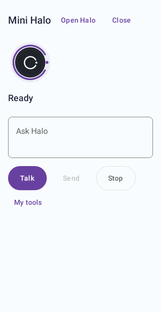
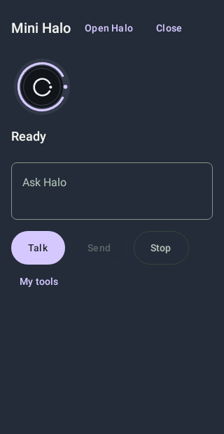
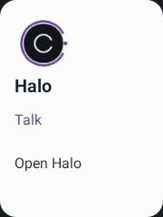
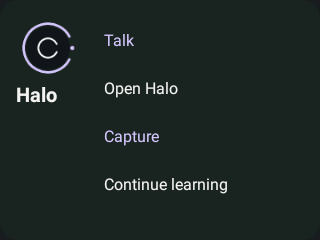

# Halo UI polish, Mini Halo and native launch surfaces — 2026-10-14

Base: e3564f1afb0c92bb53798e641f5aa0f136df5cc9, pulled before changes.

## User flows

Settings → Halo nearby offers Open Mini Halo, Show/Hide floating Halo, and Add Halo widget. The overlay permission is requested only when the user chooses floating Halo. If the launcher cannot pin widgets, Halo explains how to use its widget picker.

Mini Halo uses the existing activity bootstrap, Home view model, conversation, runtime and global approval surface. It has a bounded dialog-themed native window, Talk, an editable question/tool request, Send, Stop, and a tools section with Camera, Notebook and Study. Open Halo continues in the full app. Closing/backgrounding the compact surface cancels its microphone input. The runtime and wearable bridge remain process-owned.

The collapsed floating orb opens Mini Halo. Drag it to either screen edge to snap; drag it to the visible dismiss target or hold it to hide. Its position is stored as screen fractions and clamped after configuration changes. The foreground notification also offers Hide. It is opt-in, not boot-restored, and stops on screen lock or overlay-access revocation. It performs no inference, recording, screenshot capture or native tool execution. The live compact window owns those reviewed interactions.

The existing native widget now supports compact and wide layouts. Both follow Halo's selected appearance mode, light/dark accent and background tone. The orb is a static launch image, not a claim about runtime readiness. Talk opens Mini Halo, where the user starts microphone input. Capture supplies a reviewable camera request and requires Send; it never executes a command from the launcher broadcast. Continue learning opens Study. Small widgets at large font sizes reduce controls to keep the orb and Talk reachable.

Palette/appearance persistence and interface-language changes refresh existing widgets. The floating orb refreshes after palette/appearance changes. Normal app resume and widget option changes refresh widget rendering; launcher-specific updates while the process is absent need physical verification.

## Shared visual changes

The active orb ring follows the chosen accent across screens. Approval, warning, error, success and offline states retain their semantic colours. Shared screen headers no longer truncate enlarged titles at two lines. Settings identity and destination icons use shared shape/spacing tokens. Screen card/control shapes in Home, device screens, Android Assistant, on-device models, routines, diagnostics, Study, Notebook, note editing and conversations now use the common Halo shapes rather than local corner values. Existing provider, voice, inference, storage and tool policies are unchanged.

Screen requests are claimed atomically by the resumed host before navigation, so the background full app does not consume Mini Halo's request. The compact host is non-exported and uses a separate task affinity; full Halo and Mini Halo share the same process runtime.

## Validation and acceptance

Representative captures cover Mini Halo in light/dark and EN/RU/LV at narrow width and enlarged text, plus the native widget layouts and existing shared Settings/Home components. Reduced motion is used only for stable screenshot recording. Fixtures do not prove microphone/TTS quality, model availability, actual tool effects, launcher compatibility or physical overlay behaviour.

Final results, APK hashes and images are recorded after the final run. Device checks must cover launching over another app, keyboard/rotation, drag/hide, notification stop, permission revocation, screen lock, recreation, switching to full Halo with a draft/turn, durable approvals, and widget resizing/theme changes. ADB currently shows no connected device, so physical acceptance is open.

## Platform references

- [Application overlays](https://developer.android.com/reference/android/view/WindowManager.LayoutParams#TYPE_APPLICATION_OVERLAY)
- [Foreground service types](https://developer.android.com/develop/background-work/services/fgs/service-types#special-use): the optional overlay launcher uses a declared `specialUse` foreground service. Any Google Play release needs the applicable foreground-service declaration/review; a local APK build does not establish store acceptance.
- [Native widget constraints](https://developer.android.com/develop/ui/views/appwidgets)

The initial compile found a Kotlin setter-name collision, repaired before the verification gate. The first widget snapshot run failed because the test view lacked an Activity host; its renderer was then attached to a real Robolectric Activity.

## Design diagnostic

Refactoring UI score: 9/10 (7 of 8 rows verified in the reviewed captures). Hierarchy, whitespace, label emphasis, shared spacing, constrained widths, text contrast and suitable card/window elevation pass. A separate blur/grayscale assessment across the wider screen set is still open; it is not counted as a pass. The reviewed Mini and widget captures have no remaining clipping or untranslated controls. This is a scoped visual assessment, not certification of every page or launcher.

The collapsed orb is hidden while a Halo host is resumed, including Mini Halo, so it does not cover Halo's own controls. A host set supports multiple visible windows; closing one does not reveal the orb while another remains visible. The service remains enabled and the orb reappears over other apps. Screen lock or explicit Hide stops it entirely.

## Final verified gate

- 48 focused tests, 0 failures/errors, 0 skipped; both debug and Android test APK builds passed on the final production sources.
- EN/RU/LV catalogue: 2373 strings checked; diff whitespace check passed.
- Current reviewed captures and suite counts are saved in `artifacts/HALO-NEARBY-UI-2026-10-14/`. Settings fixtures show the shared visual components; they do not exercise the real Settings view model or a live provider. Widget images are native RemoteViews rendered in a Robolectric Activity, not a physical launcher's capture.
- Debug APK SHA-256: `8BE845EF25C0F602E7366993E59A522C94EDF04D457607CE52E2447097E782A7`.
- Android test APK SHA-256: `FDAE62689DF48851022A148A40C415655F8D1C6B59D13DB93FD9E2B43260A9B3`.
- Final ADB checks found no connected devices. APK installation, native floating-window/launcher acceptance and physical audio/tool effects remain NOT_RUN for this batch.

Representative layouts:






Reproduce:

```powershell
.\gradlew.bat :app:testDebugUnitTest --tests '*MiniHalo*Test' --tests '*BubblePositionTest' --tests '*HaloWidgetVisualTest' --tests '*Palette*Test' --tests '*AppearancePreferencesTest' --tests '*HaloScreen*Test' --tests '*HaloIdentitySnapshotTest' --tests '*SettingsComfortSnapshotTest' --tests '*HomeComfortSnapshotTest' --tests '*HaloVisualLanguageSnapshotTest' :app:assembleDebug :app:assembleDebugAndroidTest '-Proborazzi.test.record=true' --no-parallel --max-workers=1 --no-daemon '-Dorg.gradle.jvmargs=-Xmx2g -XX:MaxMetaspaceSize=768m'
python scripts/generate_ui_languages.py --check
```
