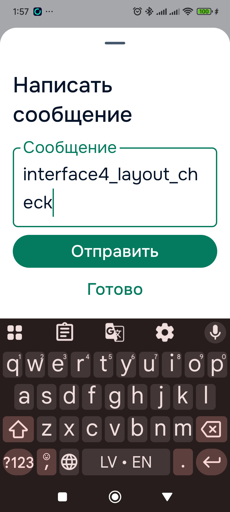
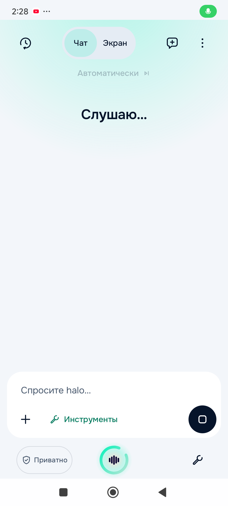

# Interface 4.0 integrated verification

Work started on `main` at `045f98506f30797974311fe27e80645e0cf20d01` for [#62](https://github.com/slafftrosheen/Halo/issues/62). Dates below span 2026-10-24/25 Europe/Riga. This ledger separates implementation, desktop fixtures, native fixtures and actual production-Activity checks. **Engineering integration and the recorded regression/device checks passed. KEEP_OPEN: positive spoken invocation, live capture continuity across routes and remaining full acceptance are not established by these results. No closure is inferred from compilation or callback fixtures.**

## Delivered implementation scope

- One shell Orb, compact profile control, PTT/finish/interrupt/review semantics, bounded long-press fan and accessible destination list. Home/Screen/Mini reuse the existing conversation, speech and action owners.
- Upper page overflows and ephemeral current-page callbacks across ten screen families. Entry/object/source identity, enabled state and current callbacks are checked before dispatch. Typed input can remain on the current page.
- Canonical adapters for appearance/profiles, native Screen configuration, saved devices/notifications, Voice/Learning preferences, routines, provider checks, speech inventory, active Study and Canvas selection/media/export workflows. No second cognition, tutor, downloader or automation engine.
- Exact source/selection/review guards, transactional writes, honest asynchronous receipts, conservative approval and replay rules, and Workspace-category disclosure for personal metadata.
- Strict bundled discovery manifests, including all 76 runtime-owned Workspace operations; reduced-motion/lifecycle/static fallback corrections; four previously missing supplied SVG twins; EN/RU/LV/PL action labels.

Detailed matrices: [screen preservation](INTERFACE-4-SCREEN-PARITY.md), [assistant operations and exceptions](INTERFACE-4-ASSISTANT-PARITY.md), [Screen tools](INTERFACE-4-SCREEN-TOOLS-PARITY.md), [configuration discovery/privacy](INTERFACE-4-CONFIGURATION-DISCOVERY-PRIVACY.md), [active Study](INTERFACE-4-ACTIVE-STUDY.md), [provider checks](INTERFACE-4-PROVIDER-CHECKS.md), [speech inventory](INTERFACE-4-SPEECH-INVENTORY.md), [motion](INTERFACE-4-MOTION-CATALOG.md).

The [route/action index](interface4/route-action-index.json) is a reproducible lexical before/after index, not proof that every journey ran. It recognizes 154 interactive source files and preserves all 62 recognized route declarations. The semantic matrices and tests provide the separate owner/action evidence.

Learning configuration specifically shares `LearningConfigurationOwner` between the existing Settings ViewModel and typed adapter. The adapter changes the existing five preference fields, not memories, proposals, grants, remote consent or reflection execution. UI edits, token invalidation, readback and uncertain partial storage writes have dedicated regressions.

## Build and test checkpoints

Common environment: Android Studio JBR, Gradle wrapper, `--max-workers=2 --console=plain`, no new CI. Later full gates include app tests, cognition, interpretation, language, Sherpa inventory tests, debug APK and instrumentation APK. `-Proborazzi.test.record=true` is quoted in PowerShell.

| Checkpoint | Actual outcome | Recovery |
|---|---|---|
| 1, initial coherent UI batch | App production/test compilation; 195 app cases, 2 failures | Supplied static twins and duplicate Robolectric asset paths |
| 2, comprehensive UI regression | Both APKs; 1,864 app cases, 22 failures; 418 non-app cases passed | Migration/Graph/inspection fixtures and changed current UI labels |
| 3, grouped recovery | Both APKs; 422 affected app cases, zero failures/errors/skips | Includes cramped 200% layout regression |
| 4, semantic integration | 459 non-app cases passed; app compile failed | Audio-control revision `Int` adapted to `Long` |
| 5 | Kotlin IR backend failure in nested suspend default | Explicit awaited routine persistence callbacks; rollback retained |
| 6 | Both APKs; 1,965 app cases, 12 failures | Seven required manifests missing; strict loader retained |
| 7 | Both APKs; 1,967 app cases, one fixture failure | Full profile-owner fixture replaces old eight-tool assumption |
| 8 | Both APKs; 1,971 app cases, one fixture assertion failure | Assert actual on-demand policy, rather than legacy PHONE_ACTIONS grouping |
| 9 | Both APKs; 1,979 app and 462 supporting-module cases passed, zero failures/errors/skips | Actual compact-mode fix passed; physical repeated-root request still failed because saved child stack restored |
| 10 | Both APKs; 102 focused cases passed; native 12 PASS, one opt-in NOT_RUN | Exact primary requests disable saved child restoration; existing callers retain restoration |
| 11 | Both APKs; same 102 focused cases passed | Compact idle no longer creates its pulse clock; first cold sample still contained startup and redraw work |
| 12 | Both APKs; same 102 focused cases passed; final native 12 PASS, one opt-in NOT_RUN | Task pill uses a static status icon rather than a second looping Halo; 200% portrait/landscape passed |

Two additional invocations failed before compilation: checkpoint 4 split an unquoted `-P` argument; checkpoint 10 put task-specific `--tests` after the assembly task. Both command invocations were corrected. It is retained as an invocation error, not hidden as a passing build. No build was run per file edit; recoveries followed integrated compiler, regression and physical findings. Compact per-suite results live in `interface4/*-results.json`; raw XML and local device traces are retained under ignored `.artifacts/interface4/`.

## Device provenance and findings

Physical target: Redmi `23124RA7EO`, Android 15/API 35, serial `f01fe673`. App package `com.aistudio.braintool.xkqzps`. Both package paths and installed base-APK SHA-256 are read back after installation; a successful install command alone is not the identity check.

| Installed checkpoint | App SHA-256 | Native evidence |
|---|---|---|
| 2 | `3109f5a66b25e7a96f471b224d700e9401fb880d9e6152ce6876cf852450766d` | Six isolated production-Orb surface cases passed |
| 3 | `833fc40fb20217336c1f2c594d421acce024a1b7a865de99307b83d65007f586` | Same six passed; two real HTTP/WebView owner tests passed using loopback TLS |
| 8 | `edf8738fb2bfe8714152f0dfefc7912210e21294c1075d682b6bd3f91cfbc3cb` | Orb six, private owner two and Mini three passed; real Main repeated intent failed; quiet capture NOT_RUN |
| 9 | `3277f64c8b33437b1bf7ed3c9b3503491b12420f4b66f158743cc6c712359b8c` | Eleven passed, one real Main repeated-intent failure, one opt-in capture NOT_RUN |
| 10 | `5c057808f35cb3584ec8d279b26952b92d8ded284db9eb46b6c5bf95e99922d8` | Twelve PASS, one opt-in NOT_RUN; repeated warm/resumed root navigation fixed |
| 11 | `bb8be8e8ffe9695788cfa972dddb421eecbafd9c6733a611706e2fa8d984eb48` | Actual Private microphone/recognition/error recovery; acoustic phrase NOT_ESTABLISHED |
| 12 | `ff00a95371eb747f3041d0972aa8288b8560412aa8e61323c77a02fb744aeeaf` | 360dp/200% portrait, 800×360dp/200% landscape menu and Back passed; native 12 PASS, one opt-in NOT_RUN |

The six Orb cases render production controls with isolated callbacks; they do not establish live microphone, persisted privacy or model behavior. The two privacy cases use real production network owners and synthetic loopback data; they are not successful real provider requests. The Mini cases exercise real Activities and lifecycle release boundaries, not audible speech continuity.

Actual phone interaction also exercised Workspace navigation, long-press list fallback and Android Back in measured landscape. Requested orientation is never substituted for the XML hierarchy's measured rotation. One provisional fan selector hit the underlying Chat/Screen switch and is explicitly invalid evidence. A later candidate search did not establish fan-touch success either.

Checkpoint 8 found two concrete production defects: repeated warm page intents remained pending, and the 360dp/200% Russian profile label became a four-line tall button. The resumed lifecycle collector consumed repeated requests, but checkpoint 9 exposed a second cause: tab-style restore reopened Voice above Workspace. Exact root navigation now disables that child restoration and has three real NavHost regressions; checkpoint 10 passed the identical physical repeated/resumed-intent reproduction. The compact presentation passed the same measured 360dp/200% reproduction at about 59dp high, with its full accessible name retained.

Device display baseline was physical 1080×2400, density 440, font scale 1.0, free sensor rotation, default fixed-rotation policy, user rotation 0. Display test overrides are restored in `finally`. Plugged-in stay-on setting 15 is preserved. Existing profile was Power on reconnection; test fixtures do not activate or acknowledge new sharing. No user data reset, credential edit, model download, paid request or new OS permission grant was used for these checks.

## Evidence boundaries and preservation

Actual spoken STT-final commands, human-heard playback, model quality, stylus hardware, Play commerce and broader Android alpha acceptance remain separate in [#55](https://github.com/slafftrosheen/Halo/issues/55). Prior voice evidence on an older fingerprint is retained there and is not relabelled as current-binary PASS. The opt-in real capture test defaults to NOT_RUN and requires existing Private/local/buffered readiness and an explicit quiet-capture decision; it does not promise a mathematical pre-STT fence against arbitrary ambient audio.

Raw drawing, OS secure grants, credentials/OAuth, expanded sharing/paid consent, hardware qualification and human confirmation of audible output remain documented protected exceptions with their nearest existing semantic operations. Unavailable model/provider dependencies are not fabricated successes.

Two pre-existing unfinished untracked files, `ComposerDraftStore.kt` and its test, are preserved byte-for-byte and excluded from the commit. Their source was present in the workspace build inputs; the unfinished test class alone was filtered by the local init script. No tracked test was excluded. Source witnesses record these inputs rather than claim a pristine-commit build. No source reset/stash, force push, new service or GitHub Actions workflow is part of this change.

## Physical presentation samples and commands

[Sanitized checkpoint 9 device results](interface4/checkpoint-9-device-summary.json) record measured bounds and artifact identity. The 411.43dp portrait fan opened the actual Workspace. At 360dp/200%, the typed sheet kept Send and Done above the actual keyboard, cleared the synthetic draft without submitting, and returned to Workspace.



Comprehensive checkpoint 9 command (the final focused recovery is reported separately):

```powershell
$env:JAVA_HOME = "C:\Program Files\Android\Android Studio\jbr"
.\gradlew.bat :app:testDebugUnitTest :runtime:cognition:test :engines:interpretation:test :libraries:halo-cognition-language:test :providers:sherpa-stt:testDebugUnitTest :app:assembleDebug :app:assembleDebugAndroidTest "-Proborazzi.test.record=true" --max-workers=2 --console=plain --continue -I .artifacts/interface4/exclude-unfinished-draft.init.gradle
```

The local init file filters only the named unfinished untracked test class; a clean checkout without those user files needs no filter. Generated translations check: 4,089 entries per EN/RU/LV/PL UI catalogue; Polish Android coverage: 4,916 strings.

## Final recovery and actual evidence boundaries

Checkpoints 10–12 each ran the same 102 affected app tests (overlapping, not additive), both assemblies, and the following task-specific filters before the assembly task:

```powershell
.\gradlew.bat :app:testDebugUnitTest --tests "com.halo.app.ui.shell.*" --tests "com.halo.app.ui.presence.*" --tests "com.halo.app.ui.components.CompactPrivacyModeButtonTest" --tests "com.halo.app.di.tools.host.NavigationToolsTest" :app:assembleDebug :app:assembleDebugAndroidTest "-Proborazzi.test.record=true" --max-workers=2 --console=plain --continue -I .artifacts/interface4/exclude-unfinished-draft.init.gradle
```

There were 12 integration/recovery checkpoints and two separate corrected invocation errors (14 Gradle invocations total). Seven main-APK installs (2,3,8,9,10,11,12) and five instrumentation-APK installs (2,3,8,9,10) succeeded. Checkpoints 11/12 reused the byte-identical installed instrumentation package and verified its base-APK hash. Final instrumentation SHA-256 is `d76642095bcb702cce684ff49a7fd2339b7c2ab4e9afa5762ef01266ab32f6d8`; final main/test sizes are 289,581,146 / 1,949,934 bytes.

[Eight requested main screens](interface4/checkpoint-10-route-smoke.json) each rendered its known UI marker, exactly one Talk target and the same Power control. The [final large-text checks](interface4/checkpoint-12-layout-results.json) measured rotation 0/1, a bounded privacy target, a scrollable landscape list, and Back retaining Workspace. Tablet and physical TalkBack/hardware-keyboard qualification were unavailable; desktop fixtures are labelled separately.

[Real Private microphone attempt](interface4/checkpoint-11-acoustic-attempt.json): the global Orb opened the microphone (OS indicator and Listening UI), automatic endpoint entered recognition, and the app truthfully rejected insufficient voiced audio with recovery. PC-synthesized speech did not establish the requested phrase or navigation. This is a negative physical path, not successful spoken input or audible-output PASS. The original Power profile was restored through the same existing control; no new sharing acknowledgement or permission was accepted. Human spoken invocation/playback and cloud alpha acceptance remain unverified here.



Resource observations: compact idle now uses its supplied static artwork. The separate global waiting-task pill no longer loops a 32dp approval Lottie or draws a second Halo identity; Review/Stop and task truth remain unchanged. Short CPU samples are in `checkpoint-{9,10,11,12}*sample*.json` and the thread comparison. Main/render redraw activity decreased in the final observation, but WorkManager was active and this was not a controlled idle/battery qualification. Do not convert it into an energy, sustained-load or leak PASS. Android animator scale was temporarily zero only for the diagnostic comparison and restored to its original unset value.

Final native command (raw status codes distinguish the one assumption skip from twelve passes):

```powershell
adb -s f01fe673 shell am instrument -w -r -e class "com.halo.app.ui.presence.InterfaceFourDeviceTest,com.halo.app.ai.PrivateDispatchOwnerTraceTest,com.halo.app.ui.shell.MainActivityScreenIntentPhysicalTest,com.halo.app.ui.mini.MiniHaloActivityPhysicalTest,com.halo.app.ui.shell.GlobalTalkCapturePhysicalTest" com.aistudio.braintool.xkqzps.test/androidx.test.runner.AndroidJUnitRunner
```

[Final native cases and APK readback](interface4/checkpoint-12-native-summary.json): 12 PASS, zero failures, one opt-in NOT_RUN. The opt-in quiet capture skip is not silently converted by the separate negative acoustic attempt into live capture continuity or successful speech PASS. Source/typed contracts passed; real positive typed/spoken cross-tool acceptance still belongs to the explicitly unverified matrix. #62 remains open for those acceptance gaps while validated implementation is published and independent #55 work continues.

Public logs retain comprehensive checkpoint9 and final recovery12. Older raw logs remain under ignored local evidence; compact per-suite JSON summaries retain their outcomes. Public log copies normalize trailing whitespace; original local logs remain unchanged.

## Android continuation — 2026-10-25, checkpoint 15

[The dated Android acceptance ledger](ISSUE-55-ANDROID-ACCEPTANCE-2026-10-25.md) records subsequent shared encrypted Home/Orb draft recovery, bounded singular-one action routing and canonical independent note-title support. The previously preserved draft stub/test were deliberately completed in that follow-up, original three tests retained; checkpoint 15 uses no unfinished-test exclusion. Its 594 affected app tests pass, with 13 native passes and 1 explicit quiet-capture NOT_RUN, plus real unsent-draft cold-restart/isolation/shared-editor readback and a genuine free-cloud named-note write/readback. Exact APK hashes, source provenance, overlap and fixture boundaries are in that ledger.

These results do not establish current positive spoken capture, live navigation capture continuity, audible output, all tool workflows or full #62 acceptance. #62 remains KEEP_OPEN. The earlier checkpoint tables remain historical evidence for their recorded binaries.

Checkpoint 16 additionally removes repeated catalogue reconstruction with fresh per-operation snapshots while preserving live execution checks. The dated Android ledger records 362 runtime/594 affected app passes, 13 native passes/1 quiet-capture NOT_RUN, actual phone timing samples, and unqualified experimental input diagnostics. This does not complete #62 acceptance.
