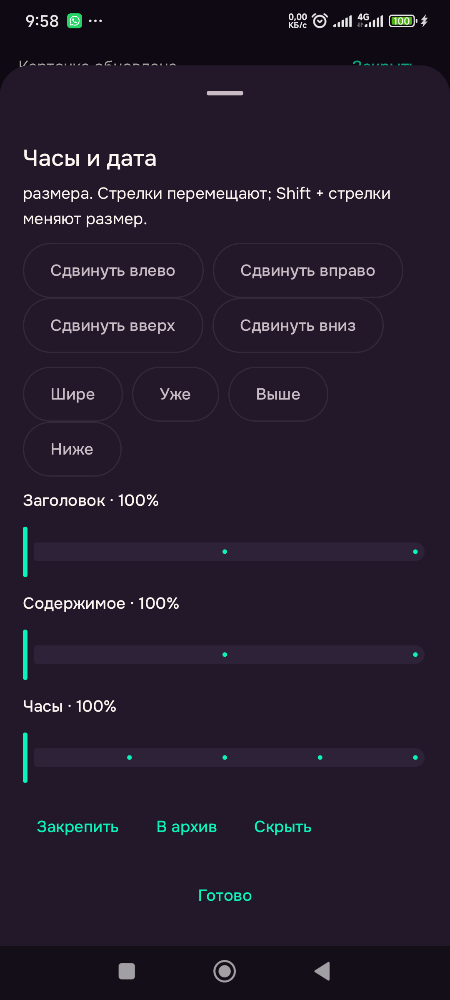
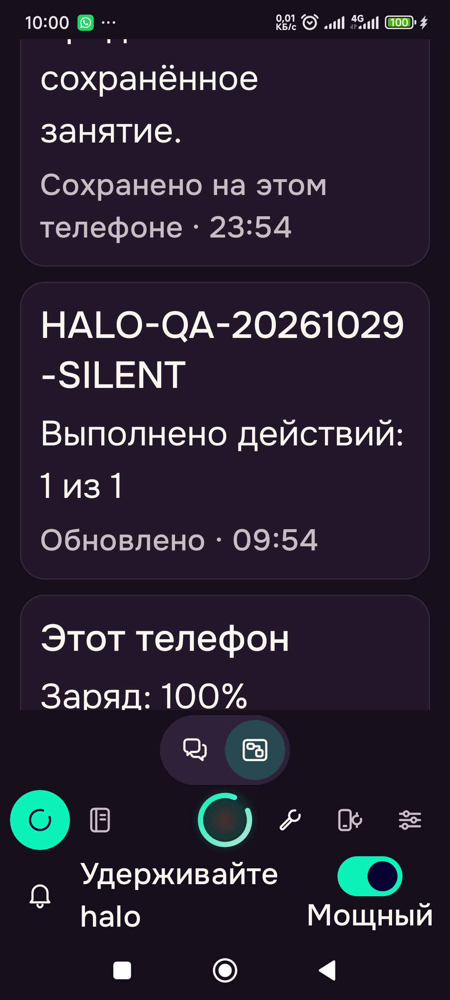
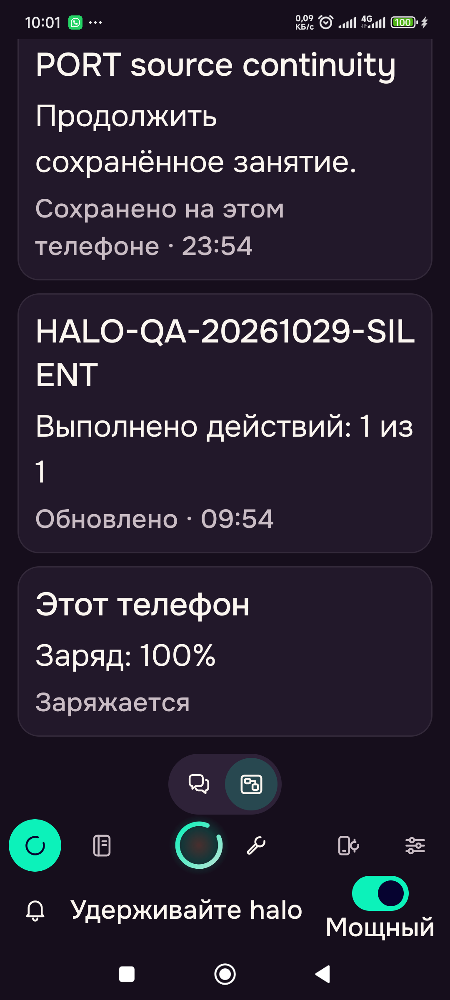
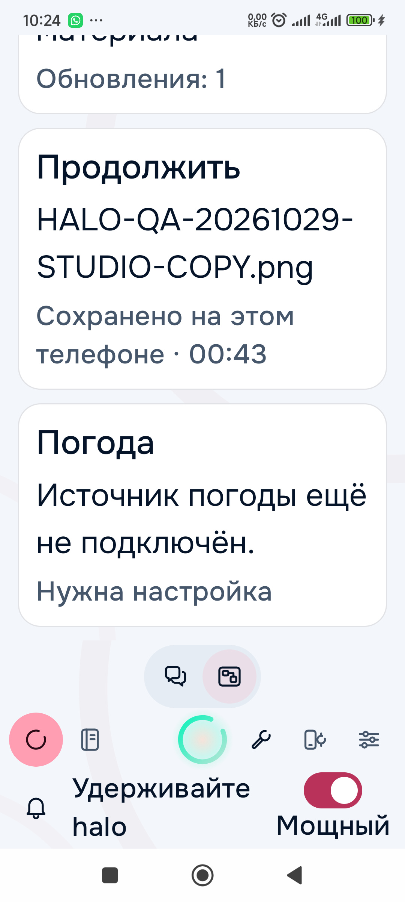
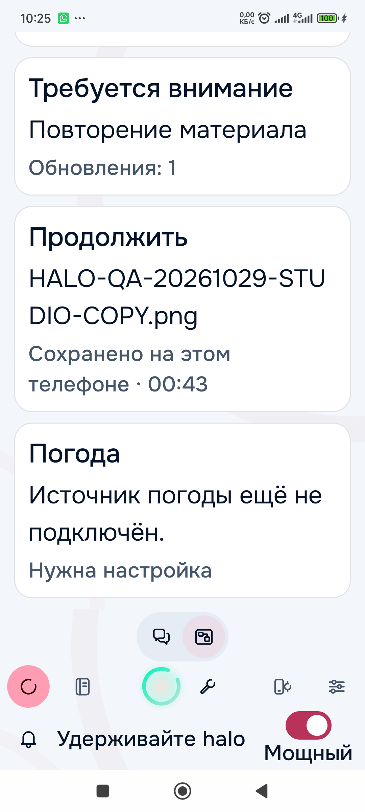

# Issue 60 — focused acceptance, 2026-10-30

Issue: [Halo Screen & Presence](https://github.com/slafftrosheen/Halo/issues/60).
This checkpoint reuses the implemented native Screen owners and previous scoped ambient evidence. It does not qualify unrelated issues or all Android behavior.

## Shipped correction and build identity

Screen card options displayed literal English **Pin/Unpin** in Russian. Commit `eee81b805698a70058cf4f9e775d703caa52d9bb` replaces those two lookup misses with explicit EN/RU/LV/PL Android resources. Pin state, layout persistence, callbacks and semantic owners are unchanged. Both Russian states were observed on the phone; cancelling the edit retained the saved pinned state.

- Preceding source `53ffc6153cbda85a48fd1abb4b2037fa9839355b`: **65 tests / 9 classes**, zero failures/errors/skips, app lint and assembly, frozen source unchanged. This is a focused gate, not a repository-wide rerun. [Gate](issue60/2026-10-30/focused-gate.json).
- The two-label delta: four-locale XML validation and successful app assembly, frozen source unchanged. The 65 earlier tests are not relabeled as a new test run. [Assembly](issue60/2026-10-30/pin-assembly.json).
- Installed app SHA-256: `5fd833042484d3560fc30625f6de59faa7deb3b3e9e43e114bb1db7e5872cca8`, independently read back from the installed APK. Device: Redmi 23124RA7EO, Android15.

## Actual native phone results

| Check | Result and precise scope |
| --- | --- |
| Chat ↔ Screen / app update | An exact ownQA unsent draft survived mode switching, the APK update and reopening Chat. Cleared only that exact QA draft afterward, without sending it. Other conversation contents were not edited. |
| Four real card types | Clock, Study continuation, routine result and phone status survived the APK update/process restart with the saved layout unchanged. The phone card changed from95/96% to100%, matching Android battery/charging observations. |
| Exact source navigation | Study opened session `ea09dbc3-86ab-4e3f-8548-c57a8040c409`, retaining its exact saved source/revision and draft. Workspace continuation opened the exact ownQA exported PNG. Routine result opened its exact saved routine. |
| Routine source refresh / deduplication | One explicitly confirmed manual silent run completed1/1 with `SURFACED_SILENTLY`. The existing `automation:82c665d8-93de-496f-93df-28e2922df5a1` publication updated once with typed counts and the actual producing routine revision. Russian Screen copy displayed **Выполнено действий: 1 из 1**; canonical English source summary stayed literal. Routine remained OFF with no scheduled next run. |
| Layout preview / apply / cancel | Added Study/routine/device through actual previews and Apply. Two-axis resize and pin changes were cancelled without changing persisted layout/version. A typed five-card native request produced a reviewed whitelist proposal without applying it. Requesting only already-present cards was rejected as a no-op; no duplicate cards were written. This was the native bounded text interface, not model or spoken interpretation. |
| Reset / Undo | Actual Quiet preview and Apply produced the two-card Quiet layout; persisted Undo restored the original Morning content exactly with increasing versions. Source notes, Study and routines were retained. |
| Native geometry / named preset | Actual Narrower, Taller and Move down controls saved clock placement column0/row1/width6/height2 in the normalized twelve-column schema. The five-card layout survived force-stop exactly. An ownQA named preset also survived, loaded through native UI, and was removed after Undo restored the original Morning content. Final layout version16; versions increase instead of resurrecting old preview authority. |
| Light/dark Russian large text | Actual360dp and approximately412dp (density419) at200% text: dark captures show the fresh routine count and phone card; light captures show Workspace continuation and truthful unconfigured weather. All four fixed roots remain present. Captures were inspected for readable card content. This is not whole-app accessibility or every interaction at large fonts. |
| Restore | Original layout content restored; temporary QA draft and preset removed; font1.0, default density440, automatic rotation1/user_rotation0 and original keep-awake15 restored. Original DARK mode, both saved palettes and visual options were read back unchanged after the temporary light-mode checks. AI profiles were not edited. |

[Sanitized native readback](issue60/2026-10-30/native-checkpoint.json).

## Rendered evidence

The screenshots contain native controls and ownQA card data. Partial cards at the upper/lower edge are ordinary scroll-viewport clipping, not a claim that all card content is simultaneously visible.

## Closure boundary

The ordinary Chat/Screen preservation and four-card persistence/source-link acceptance now have real phone evidence. Preserve those completed results instead of repeating them.

Issue60 remains OPEN: actual spoken layout requests are deferred; live secure keyguard/dock and low-power/dimming transitions, and physical TalkBack/peripheral equipment remain separately unqualified. The physical phone light/dark matrix, custom preset and native geometry persistence checks above are complete at their stated scope. Earlier unit and ambient checks remain accepted only at their documented scope. No universal AOD, battery, microphone or full accessibility PASS is inferred.
