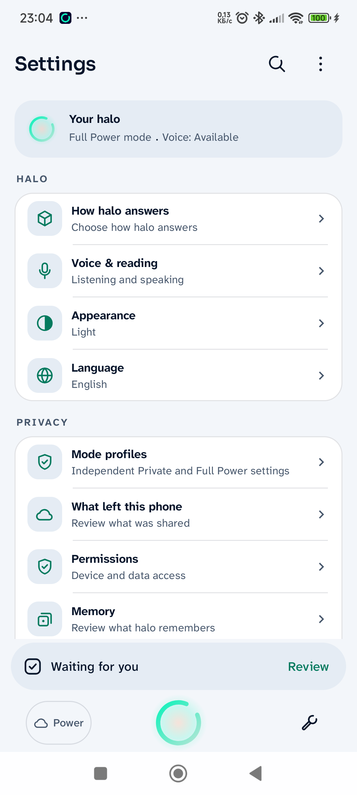
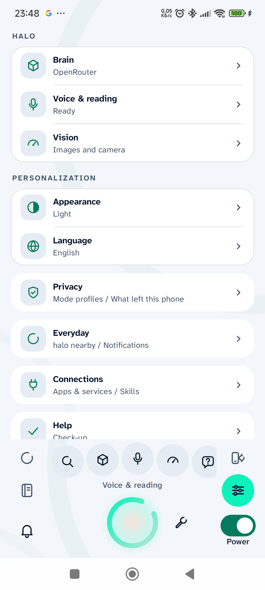

# Initial physical Settings comparison

These are unaltered captures from the same physical Android15 phone at its original density440 and font scale1.0. The before image is checkpoint25; the after image is the installed05 redesign. This pair demonstrates the visible hierarchy and shell change. It does not qualify subsequent editor, compact-footer, locale or copy repairs, or final-binary installation.

| Before (checkpoint25) | Initial redesign (checkpoint05) |
| --- | --- |
|  |  |

Exact APK and image hashes are in [capture provenance](settings-capture-provenance.json). Additional root/nested/responsive raw captures remain in the local evidence directory named in the [delivery ledger](../../ISSUE-62-INTERFACE-DELIVERY-2026-10-25.md). Final physical qualification is pending reconnection.
