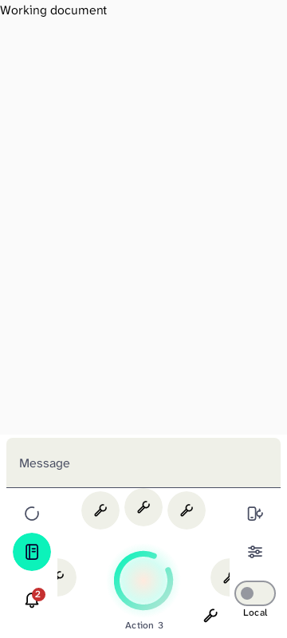
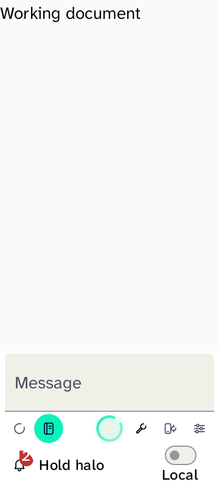
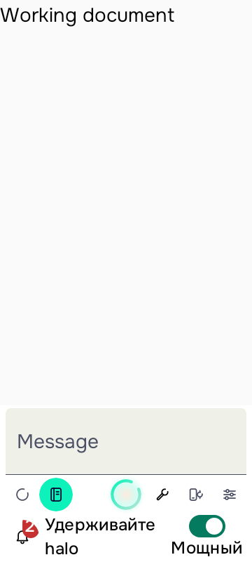

# Interface 4 source completion and host renders

Implementation: [requirement/source map and protected operation contracts](../../ISSUE-62-IMPLEMENTATION-COMPLETION-2026-10-26.md).

The images below were freshly recorded and visually inspected after the coding/source-review phase. They render the actual Halo Zone composables with **synthetic tool actions and work/composer fixture content**. They are **not screenshots of the real app or physical phone**, and do not qualify all screens or actual speech. The fixture intentionally disables the ambient backdrop. Hashes, fresh timestamps and exact source witness are in [render-fixtures.json](render-fixtures.json).

## Normal 360dp orbit

Four stationary root icons, separate bell/profile, fixed Orb and explicit action list; the context track has been deliberately dragged/snapped. Partial edge tools are the bounded scroll viewport's peeking items, not extra root destinations. Synthetic wrench icons are fixture data.

## Compact / 200% font fallback

The root icons remain fixed; the explicit full list replaces the arc and keeps the PTT/list hit areas separate.

## Russian / 200% font Power control

The real compact mode control and instruction remain readable within their separate bounds. English working-document/composer labels are synthetic fixture content.

The corrected Settings/Appearance and orbital fixture/geometry recovery passed **23 tests**, with no failures/errors/skips and both APK assembly checks successful. The subsequent final complete app regression passed **2194/2194**, zero failures/errors/skips. See [completion-gate.json](completion-gate.json); the targeted23 and Notebook26 recovery cases overlap that full count. Physical device, complete cross-tool journeys, TalkBack/hardware, speech/audibility and permitted-provider acceptance remain separate; the phone was not attached.
